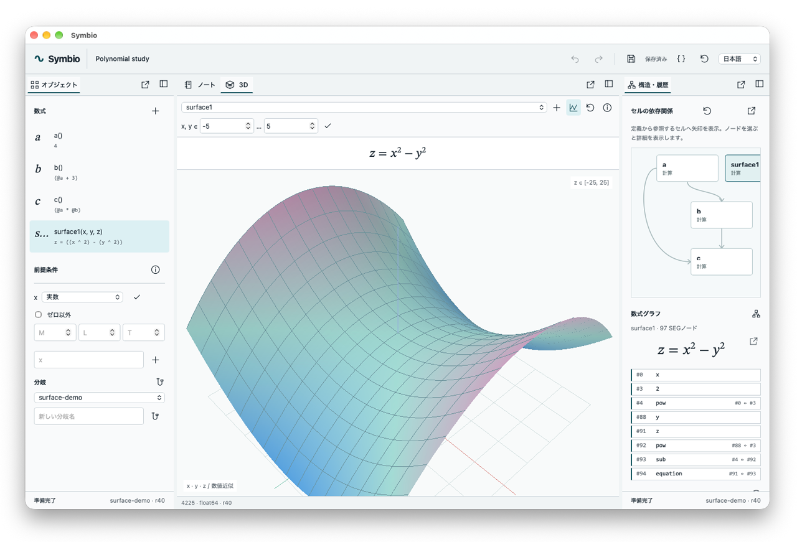
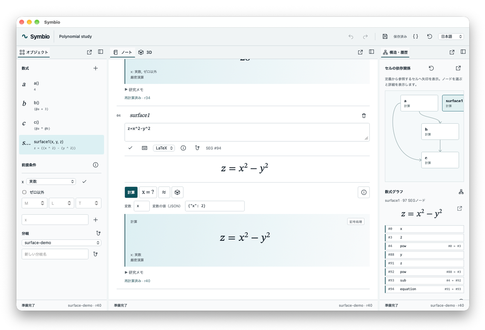
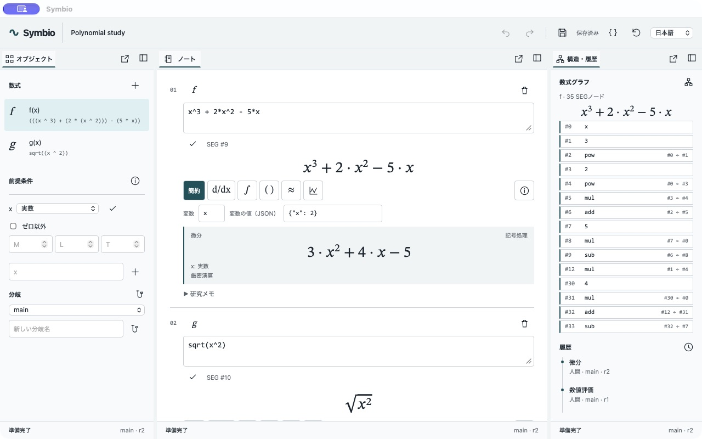

# Symbio · Symbolic Intelligence Workbench

<details><summary>Earlier development screenshots</summary>




</details>

Symbio is an early reproducible derivation and research notebook built with Tauri 2 and Rust. It keeps mathematical meaning, assumptions and research history together, with the same Rust kernel serving both the desktop UI and CLI. It reuses ThreeX's wgpu renderer and ATOM's native panel infrastructure.

**The current release is a Semantic Expression Graph (SEG) MVP. Mathematica compatibility, advanced CAS algorithms, LLM integration and formal proof engines are not implemented.**



## Build and run

Generate the unsigned macOS development app locally. Rust/Cargo, Xcode Command Line Tools and Python 3 are required. No Node/npm frontend build is needed.

```sh
python3 scripts/build-dev-app.py
open target/debug/Symbio.app
```

To open a specific document, create its parent directory first, then run:

```sh
cargo run --locked -p symbio-desktop -- --project /absolute/path/study.symbio
```

If the document does not exist, Symbio creates polynomial and `sqrt(x^2)` examples. Without a project argument, it uses `workspace.symbio` in Tauri's application data directory, normally `~/Library/Application Support/dev.symbio.workbench/` on macOS. Dock layouts are stored in `dock-layout.json` in the application configuration directory. Set `SYMBIO_LAYOUT_PATH` to isolate layout persistence during testing.

The toolbar supports English, Japanese and Simplified Chinese. Expression mode requires explicit multiplication (`2*x`); LaTeX mode also accepts `2x` and previews formulas while editing. Select a cell from Objects or its numbered button to expose calculation controls. Use the pencil to edit source, the checkmark to apply edits, and **⌘S** to save. Windows and Linux builds have not been tested.

## Using the workspace

- **Left:** Add and select expressions, configure variable domains, nonzero conditions and dimensions `[M,L,T]`. Branches let you edit expressions and assumptions independently.
- **Center:** Edit source, view typeset formulas and results, and write research notes. Operations include simplification, differentiation, supported definite and indefinite integrals, matrix operations, equations up to degree two and float64 evaluation. **⌘Enter** computes the current expression. Use per-variable fields for exact substitution or numeric evaluation. Symbolic evaluation does not implicitly consume those values.
- **Right:** Inspect SEG nodes referenced by inputs and outputs, together with operation history. History records the human/AI actor, branch, revision and engine. Example results are also computed in Rust.
- Drag panel tabs to join a tab group at the center, split along an edge, or float outside the workspace as a native window. The placement menu offers the same operations. Closing a floating window returns its panel to the dock.
- Resize splitters by dragging or using arrow keys. Language, layout and window placement are persisted.
- The plot icon opens a separate wgpu window. Rust evaluates the expression at 1,024 points over `x ∈ [-5,5]`, retaining samples and rendering data in Rust/GPU memory. Only the variable `x` is supported. Undefined samples are omitted; error bounds and continuity are not certified.
- The JSON icon displays the complete document for inspection and selection. Choose a document path through the CLI or startup arguments.

Use the new-document icon immediately left of the folder icon, or **⌘/Ctrl+N**, to start an empty, untitled document without sample equations or assumptions. Its first Save opens a location picker; creating it never overwrites the previous file. New and Open retain existing documents, including their unsaved changes. Untitled documents are held in memory and are not restored after quitting.

Use the folder icon or **⌘/Ctrl+O** to open a `.symbio` document. Use **⇧⌘/Ctrl+S** or the Save As icon to choose a new location. Subsequent saves use that location; Save As preserves document history and session Undo. The save-status tooltip shows the full active path. The next launch restores the last opened or saved-as document when it still exists; `--project` overrides this preference.

The document picker beside the title keeps up to **16 documents** open in one session. Each retains its SEG, branches, results, unsaved changes, file lock and independent Undo/Redo stack in Rust. A filled circle marks edits; an empty circle marks an untitled document. New/Open activates another document without requiring the current one to be saved. Selecting an already-open file activates its existing document instead of loading a duplicate. Switches apply pending editor drafts first; invalid drafts block the switch.

The × beside the picker closes the current document. Modified documents offer **Save and Continue** or **Cancel**; untitled documents also require a save location. Cancelling either dialog preserves the document. Closing the last document creates a fresh empty one. App window closure and the app's Quit menu are blocked while any open document has unsaved edits, including inactive documents. Save each modified document before quitting. Only the last saved document location is restored on launch; the open-document set and memory-only changes are not a recovery format.

Opening a new file validates and locks it before adding it. Invalid files, lock conflicts and save failures leave open documents available. Delayed edits and snapshots from previous document generations are rejected. Layout and 3D camera/range settings remain shared session view state; selecting a document updates the graph and samples its selected cell.

Saving applies pending expression and note edits. Syntax errors cancel the save, and closing with unsaved changes is blocked. Apply pending edits before switching branches, undoing, redoing or deleting cells. Document Undo/Redo covers the most recent 32 operations in the current session.

## Reading and calculating

The notebook prioritizes typeset definitions and labelled results. Source syntax stays behind each cell's pencil; new cells open their editor automatically. Only the selected cell exposes calculation controls. Selecting an object or a reference reveals its notebook cell. Applying source or running a successful operation returns to the reading view, while invalid drafts keep their editor and hide previous outputs.

The derivative and integral controls follow the selected variable. Multivariable expressions use partial-derivative notation. **≈** opens individual numeric fields for the expression's free variables; enter every value and press Evaluate. No JSON is required, and the result retains its bindings, trust status and precision. The right inspector puts Uses / Used by relationships first, with the full graph, SEG internals and audit history available on demand. These are display changes; the Rust calculations and saved mathematical objects are unchanged.

## Math keyboard

Open the pencil on a cell to edit its source, then use the keyboard icon below the source field. Templates can wrap selected source in fractions, powers, roots or absolute values and select the next argument. The keyboard includes numbers, operators, elementary functions, cursor movement, deletion and input-specific Undo/Redo. In LaTeX mode, the calculus and matrix tabs insert directly computable templates. Use **Tab / Shift+Tab** to move between `□` placeholders.

The research-note keyboard also preserves templates from the supplied `mathkeyboard.html` in its **Notation** tab, including fractions, integrals, limits, sums and sets. The computational palette contains supported syntax; unsupported reference notation produces an explicit error. Fill every `□` before computing.

Select **LaTeX** input mode to parse supported notation into SEG in Rust and preview it as MathML. Apply the source with the checkmark, or directly invoke a mathematical operation. In a research note, use the preview icon to render LaTeX and **+** to create a separate computational cell while retaining the note. No connection to the original website or MathJax is required. Input Undo/Redo is independent of document history and retains the most recent 32 edits.

### Supported LaTeX

Switching source formats converts through the Rust semantic representation. For example, `sqrt(x^2)` becomes LaTeX with its square-root meaning preserved. Conversion rejects structures that Expression mode cannot represent, such as integral and matrix nodes, and retains the original input.

Example: `\frac{x^{3}+2x^{2}-5x}{2}` → formula preview → differentiation → `3/2*x^2 + 2*x - 5/2`.

- Arithmetic, fractions `\frac{a}{b}`, roots `\sqrt{x}`, powers `x^{2}`, implicit multiplication `2x`, parentheses, brackets and braces.
- `\sin(x)`, `\cos(x)`, `\exp(x)`, `\ln(x)`, `\log(x)` (natural logarithm), `\sin^{2}(x)` and `\left|x\right|`. Function arguments must be grouped.
- `$...$`, `$$...$$`, `\(...\)`, `\[...\]`, `\left(...\right)` and LaTeX spacing commands.
- Supported Greek letters map to variables named `alpha`, `beta`, `gamma`, `delta`, `theta`, `lambda`, `mu`, `sigma` and `omega`. For example, bind `\theta` using `{"theta":2}`. `xy` means `x*y`. `\pi` is the circle constant, and `x_1` is a subscripted variable.
- Definite integrals such as `\int_{0}^{1}{x^{2}}\,dx` → `1/3`. Indefinite integrals such as `\int{x^{2}}\,dx` return an antiderivative with an arbitrary-constant condition. Supported integrands include polynomials, constants and selected sin/cos/exp expressions. General rational-function and improper integrals are unsupported.
- Derivative notation `\frac{d}{dx}(x^{3})` and `\frac{\partial}{\partial x}(x^{3})`; finite integer sums `\sum_{i=1}^{5}{i}` and products `\prod_{i=1}^{5}{i}`, with at most 256 terms.
- Matrices such as `\begin{bmatrix}1 & 2 \\ 3 & 4\end{bmatrix}`. Supported environments are matrix/pmatrix/bmatrix/Bmatrix/vmatrix. Operations include addition, subtraction, multiplication, scalar scaling/division, transpose, integer powers, determinant and inverse. Matrices are limited to 8×8 and powers to −16…16. Inverse and determinants of matrices larger than 2×2 require rational entries.
- Equations such as `x^{2}-5x+6=0` remain SEG relations. Select **x = ?** to obtain `{2,3}`. Solving supports rational-coefficient, single-variable polynomials up to degree two over the reals. Identities, complex solutions and general simultaneous equations are unsupported.
- Limits, arbitrary TeX macros, multiple-integral symbols and higher-order derivative notation are unsupported.
- Fill all `□` placeholders before computing. Group multi-character exponents, for example `x^{12}`. Each source is limited to 2,048 UTF-8 bytes, 512 tokens and nesting depth 64. Preview does not mutate the document or certify mathematical definedness or correctness.

MathML typesets fractions, integral limits, matrices and equations. The formula focus view provides adjustable display size. Long formulas scroll horizontally instead of breaking across lines.

## Cell references and automatic recalculation

Reference another cell's authored definition with `@name` in Expression mode or `\cell{name}` in LaTeX mode. Cell names and ordinary variables are separate: `x` is a variable, while `@x` refers to the cell named `x`.

| Cell | Expression source | Initial result |
| --- | --- | --- |
| `a` | `2` | `2` |
| `b` | `@a+3` | `5` |
| `c` | `@a*@b` | `10` |

Apply `4` to `a`, and `b` becomes `7` while `c` becomes `28`. References expand definitions before transformation, so a consumer can differentiate or integrate a referenced formula, for example `\frac{d}{dx}(\cell{f})`. Integral and sum variables retain their surrounding scope.

The inspector displays a directed cell dependency graph. Arrows point from a definition to its consumers. Select a node to inspect it, open the graph in a separate native window with adjustable zoom, or use the recalculation button to run all cells. Each cell also shows its direct references, an expandable resolved definition and the revision of its latest calculation attempt.

Applying source or assumption edits recalculates affected cells in dependency order, reusing their saved operation, variable and numeric bindings. Independent cells retain their results. New definitions default to Compute. Calculation recipes and error states persist across saves and branches. Older documents recover recipes from their audit history when the original parameters are available; otherwise select an operation once to establish a reproducible recipe.

Missing references, cycles, duplicate names and deletion of referenced cells are rejected atomically. Renaming a cell updates its reference tokens while preserving cell IDs and ordinary variables. If automatic recalculation encounters a mathematical or unsupported-operation error, the edited definition remains available, affected stale outputs are cleared and an error is shown. Correcting the inputs or assumptions retries the saved calculation. Resource-limit failures roll back the edit. Pending editor drafts are applied explicitly before they affect other cells.

## Editing directly from the dependency graph

Select a graph node to edit its cell in the inspector, or expand the diagram into its native window with an editor alongside it. Edit the name and Expression / LaTeX source, preview the mathematical notation, or use the math keyboard. Apply runs the existing revision-checked definition command and replays affected cells' saved calculations. Discard restores the saved source; incomplete drafts do not change the graph or its results. A source/name/format change made in another panel is detected before a draft can overwrite it. Closing the graph window is blocked while its draft is pending; apply or discard first. The window's Save button saves the shared document.

The inspector shows live / total SEG counts and the number of unused nodes. Its collection button, also available in the graph window, removes unused structure across the entire document while retaining all branches, input definitions, expanded references, output roots and calculation metadata. Automatic collection runs after successful mutations once the arena has at least 2,048 nodes and at least 256 are unused. If an operation reaches the node limit, the runtime discards the partial attempt, collects the original valid graph and retries once. A failed retry leaves the document unchanged. Previews can collect their isolated working copy without changing the document.

Cell IDs remain stable. SEG node IDs can change during collection and must be interpreted with their document revision. Undo/Redo snapshots retain their own graphs, so collection does not delete reversible research states; their existing 32-state limit still applies. Direct subexpression manipulation and graph-edge editing remain planned.

## 3D surfaces in the central workspace

The default workspace has three columns: Objects on the left, a wide Notebook / 3D tab group in the center, and Structure & history on the right. Notebook is initially selected. Both central panels can still be split, docked or floated independently. Use **Reset workspace** to apply this default to an existing saved layout. Select a cell from its menu, use a cell's cube button, or press **+** to add a `sin(x) cos(y)` example. Expression / LaTeX definitions and resolved cell references use the same SEG as computation. Scalar expressions are shown as `z = f(x, y)`; explicit equations such as `z=x^2-y^2` are also accepted.

Drag to orbit and scroll to zoom. Arrow keys rotate, **+ / −** zoom, and **Home** resets the camera. The x and y rows set independent minimum / maximum bounds; either checkmark applies both rows atomically. The grid button toggles surface lines, colored x/y/z rulers and their numeric ticks. Ruler values use the original mathematical coordinates, including the unscaled z values. Labels follow the native camera while rotating, zooming, resizing or floating the panel; crowded or off-screen labels are suppressed. Applying formula, reference or assumption changes regenerates the selected surface automatically; uncommitted drafts do not change it.

Rust samples a bounded 65 × 65 grid and builds a shaded triangle mesh. The native wgpu surface renders behind a transparent control WebView; vertices, depth buffers and frames stay in Rust/GPU memory. Height is scaled to fit, with original z bounds displayed. Undefined samples and triangles adjacent to missing points are omitted; steep sampled jumps are also masked, which is a visualization heuristic rather than a proof of continuity. The display is a float64 approximation without an error guarantee. General implicit surfaces, parametric geometry and arbitrary variables beyond x/y are not supported. Camera and range are session view state; authored equations remain in the saved document.

## KOMYAKU integration

The neighboring KOMYAKU project uses the same `symbio-core` from its math panel for local computation. Authored LaTeX remains in KOMYAKU's Canonical/Yjs history; SEG and calculation results are derived data.

KOMYAKU's **↗ .symbio** exports the current source and its explicit assumptions. Open the resulting document in Symbio with:

```sh
cargo run --locked -p symbio-desktop -- --project /absolute/path/equation.symbio
```

KOMYAKU's **↙ .symbio** reads the selected equation from the active branch of a saved Symbio document into a reviewable LaTeX draft. Rust validates the file and converts Expression syntax when necessary. Referenced definitions are expanded into self-contained LaTeX for KOMYAKU; stored calculation results are not adopted. This integration exchanges individual equations; full document-history synchronization and `.komyaku` Archive import/export are outside its scope.

## Implementation boundaries

- SEG is an immutable, structurally shared DAG. Structural identity is distinct from mathematical equivalence.
- Integers, rationals and finite decimal input are exact. Arbitrary-precision floating point, complex numeric evaluation and certified interval arithmetic are unavailable.
- `sqrt(x^2)` simplifies to `abs(x)` for real `x`, and to `x` for nonnegative or positive `x`. It remains unchanged for complex or unspecified domains. `x/x` is not cancelled without a nonzero assumption.
- Rational-coefficient, single-variable polynomials up to degree 32 support expansion, differentiation and integration. Differentiation also covers selected elementary functions. General integration, factorization and higher-degree equation solving are unsupported.
- Cell references and recalculation are local to the active branch. References must name existing cells. Dependency expansion is bounded by the graph, source and nesting limits; unused nodes are collected automatically or through the inspector. The 16,000-node limit still bounds live structure and individual operations.
- Results are `symbolic` or `approximate`. `conjecture` is a reserved data type. The release does not issue `verified` or `certified_numeric` results or claim formal proofs or certified numerical errors.
- `.symbio` v1 is readable JSON. SQLite containers, content-addressed data, complete event replay and branch merging remain future work. The audit retains 256 events; Undo stacks are not persisted.
- The structured API accepts an AI actor attribution, but AI connections, natural-language interpretation and an MCP server are not implemented. The app makes no external network requests.

[Architecture](docs/architecture.md) · [Math API](docs/math-api.md) · [Roadmap](docs/roadmap.md) · [Provenance](docs/provenance.md) · [Validation](docs/validation.md)

## Development checks

```sh
cargo test --locked -p symbio-core -p symbio-cli -p symbio-desktop
cargo clippy --locked -p symbio-core -p symbio-cli -p symbio-desktop --all-targets -- -D warnings
python3 scripts/smoke-cli.py
python3 scripts/smoke-math-keyboard.py
node --check apps/desktop/ui/app.js
node --check apps/desktop/ui/dock.js
node --test scripts/math-keyboard.test.mjs scripts/latex-preview.test.mjs scripts/dependency-layout.test.mjs
```

Serving `apps/desktop/ui` through a static server provides a **read-only** preview of sample data generated by Rust. The browser does not contain an alternative JavaScript calculation engine.

## Research calculation contract

**Substitute** accepts exact literals such as `2`, `0.1` and `1/3`; blank fields remain symbolic. For `z = x^2-y^2`, entering only `x=2` produces `z = 4-y^2`. **Numeric** with `x=2,y=3` produces `z ≈ -5` without error guarantees. Saved recipes replay after dependency changes. Definitions and linked references are typeset, model inputs are separated from explicit outputs, and unconfigured parameters display an Unspecified domain.

Read the [mathematical contract](docs/mathematical-contract.md) and [screenshot feedback review](docs/feedback-review.md). The runtime is the bounded Rust kernel; optional `python3 scripts/smoke-research-contract.py` compares six cases with locally installed SymPy, which is not a runtime dependency.
